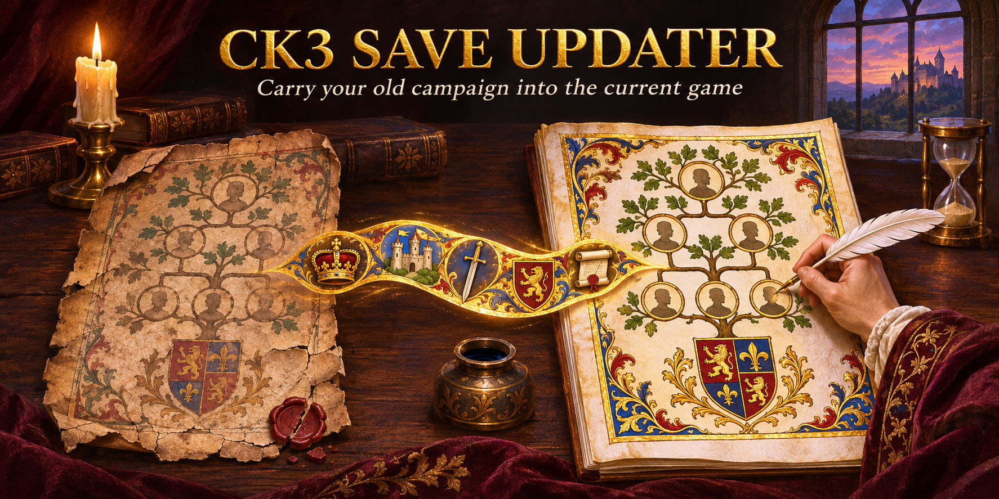

# ck3-save-updater

<p align="center">
  
</p>

[](https://pypi.org/project/ck3-save-updater/)
[](https://github.com/djdarcy/ck3-save-updater/releases)
[](https://pypistats.org/packages/ck3-save-updater)
[](https://www.python.org/downloads/)
[](https://www.gnu.org/licenses/gpl-3.0.html)
[](https://djdarcy.github.io/ck3-save-updater/stats/#installs)
[](https://github.com/djdarcy/ck3-save-updater/discussions)
[](docs/platform-support.md)

`ck3update` brings an old Crusader Kings III save forward to the game version you have installed, so the current game can load it. It removes what the new version rejects and moves data to where the new version expects it. It rebuilds the map and religion from a save written by the new version, keeping custom faiths, religious heads and every character's faith. Faces keep their look under the portrait mods you play with. Perks, regiments, innovations, county modifiers and artifact bonuses that the game renamed are matched to their new names. House feuds and running plots come across, and plots keep their agents. Artifacts keep their pictures and armour models.

## Quick start

Wherever you see `My Save`, put your save's name (with or without `.ck3`). Your save itself is never changed, the update is written to a new file beside it.

**1. Install** (Python 3.10 or newer):

```
pip install ck3-save-updater
```

**2. Make a reference save.** The tool rebuilds religion, and the regions the 1.20 map added, from a new game started by the game you have now, on your campaign's date. The game starts new games only on its own bookmark dates, so first add a bookmark on yours:

```
ck3update reference-mod --save "My Save"
```

That writes a small mod into the game's mod folder. Then, in the game:

1. In the launcher, turn on the mod **Reference bookmark _your date_ (ck3update)** and play. Your usual mods can stay off, but leave out any other mod that changes bookmarks.
2. Choose **New Game**, pick the bookmark **_your date_ Reference (ck3update)**, pick any character, and start.
3. **Save at once**, before unpausing (any name will do, e.g. `Reference`), and quit to the desktop.
4. Back in the launcher, turn the reference mod off again.

**3. Update.** Set the launcher's playset to the mods you will play with, close the launcher, then run:

```
ck3update update "My Save"
```

It prints the plan and asks "Run the update now? [y/N]". The first line is the answer: READY, or REFUSED with a `fix:` line saying what to do. Answer `y`, and it writes `My Save__updated__<game version>.ck3` next to your save.

**4. Play.** Start the game with that same playset, and load `My Save__updated__...`.

Stuck? `ck3update -h`, [Troubleshooting](docs/troubleshooting.md), or the sections below.

## What ck3update has been tested against

I used one campaign, with 34 mods, updated from 1.8.1 to 1.20.1.2, and it loads and plays in 1.20.1.2. The built-in rules cover saves from 1.8 onwards. Saves from 1.8.x through 1.19.x should work, since each game version after 1.8 has only added to what a save holds, but so far only 1.8.1 has been fully tested. Saves older than 1.8 are refused for now, and `status` names the gap. Support for them is planned. The [CHANGELOG](CHANGELOG.md) says what each release covers.

Not handled yet:

- Some things the current game removed with no replacement, such as timed modifiers from events that later versions removed. The game drops them when the save loads. [What doesn't carry over](docs/not-carried-over.md) lists each one.
- Mod content in general. You can write your own rules for a mod, though. [Writing a patch](docs/writing-a-patch.md) shows how.

For a save from before the [map rework](docs/glossary.md#map-rework), the regions it added are brought in by default whenever a reference save is found, with the rulers the current game gives them. Land your realm held stays yours, and new rulers on it become your vassals. `--transplant off` leaves this step out.

## Install

Python 3.10 or newer:

```bash
pip install ck3-save-updater
```

This installs the `ck3update` command (its old name, `ck3-save-migrator`, still works too). If your shell then says `'ck3update' is not recognized` (common on Windows after `pip install --user`, when pip puts the command in a folder that is not on PATH), run `python -m ck3_save_migrator setup`: it says where pip put the command and, on Windows, offers to add that folder to your PATH. After that, `ck3update setup` does the same ([Troubleshooting](docs/troubleshooting.md#ck3update-is-not-recognized)).

## Before you start

**The tool never launches the game, and never changes the save you give it** unless you ask for `--in-place`, and then only after keeping the original as `<name>.bak.ck3`. Every other result is a new file beside your save. (One separate command, `ck3update soak`, does start the game, and says so in its name and help; `status` and `update` never do.)

Have these ready:

- **The game folder.** The tool finds your installed game by itself through Steam's records, on any drive. If it does not, give `--game-dir "<...>\Crusader Kings III\game"` (or set `CK3_GAME_DIR`). `status` shows which install it used in its GAME block.
- **A [reference save](docs/glossary.md#reference-save)**, for most old saves: a save written by the game you have now, on your campaign's date. Religion is rebuilt from it, and the new-map regions are copied from it. The game only starts new games on its own bookmark dates, so `ck3update reference-mod --save "My_Old_Campaign.ck3"` writes a small mod into the game's mod folder that adds a bookmark on your date; enable it, start a new game from that bookmark, and save as soon as it loads, before you unpause. [The reference save](docs/reference-save.md) walks through it. Without one, `status` lists the rules that will skip and these same steps.
- **The launcher's playset**, set to the mods you will play with: the faces are carried into that playset's [gene layout](docs/glossary.md#gene-layout) (its portrait mods, read from the launcher's `dlc_load.json`). `--portrait-mods` names them instead. The faces are read in the layout the save was made with. For the old game and the 2022-2023 builds of Community Flavor Pack and Ethnicities and Portraits Expanded, the update knows it already. For other portrait mods that have updated or gone since, give the builds the save used with `--old-portrait-mods`.
- **Your [packs folder](docs/glossary.md#packs-folder)**, only if you have fixes of your own: `packs` beside the config file (`%APPDATA%\ck3-save-migrator\packs` on Windows, `~/.config/ck3-save-migrator/packs` elsewhere). The tool creates it the first time it loads rules, with `_example-pack`, a complete pack to copy when you write your own; the example itself never runs. You can ignore it to update a save.

## See what it will do: `ck3update status`

```bash
ck3update status "My_Old_Campaign"
```

Name the save by its path, or by its name in the game's `save games` folder. `status` writes nothing. It prints [the plan](docs/glossary.md#plan): what `update` will do, decided before anything runs.

Read the first line first. It is the verdict:

- [READY](docs/glossary.md#ready): `update` will write an updated save, and the line says how many patches run;
- [ALREADY CURRENT](docs/glossary.md#already-current): the save is at the game's version; there is nothing to do;
- [NOTHING TO DO](docs/glossary.md#nothing-to-do): no patch will run;
- [REFUSED](docs/glossary.md#refused): something has to be fixed first (below).

Below the verdict come blocks, one per header: SAVE, GAME, RECORD, [GAP](docs/glossary.md#gap), REFERENCE, PACKS, PATCHES (every fix in the order it runs, with why it runs or is skipped), DETECTORS, OUTPUT (the file `update` will write) and NOTES. The [glossary](docs/glossary.md#what-status-prints) says what each holds; [Configuration](docs/config.md#display-how-the-plan-is-laid-out) says how to change the layout. `--plain` prints it without colour, for pasting.

## Update it: `ck3update update`

```bash
ck3update update "My_Old_Campaign"
```

This prints the plan `status` would print, asks "Run the update now? [y/N]", and on a `y` writes `My_Old_Campaign__updated__<game version>.ck3` beside your save, with a report beside it. It checks the result ([lint](docs/glossary.md#lint)) before it finishes. Copy the new file into the game's `save games` folder if it is not there already, start the game with the mods the save lists, and load it.

- `--no-ask` runs without asking. It is also what happens in a script, or when the output goes to a file.
- Without asking, the update skips the checks that only describe the plan. That makes it faster: about 7 minutes instead of 9 on a large save. Each patch's line at the end then says what it changed, and what it does.
- `--dry-run` runs everything in memory and writes nothing.
- `--in-place` gives the updated save your save's own name, after keeping the original as `<name>.bak.ck3`; a clean result only.
- The tool remembers each campaign it updated ([the record](docs/glossary.md#record)), so the next save of the same campaign is updated with the same inputs without your giving them again.

## An advanced example

The command we use for our own long campaign, with its portrait mods and a pack of our own fixes:

```
ck3update update "My_Old_Campaign.ck3" --reference "ref_1_20_987_10_27.ck3" --old-game-dir "C:\...\Crusader Kings III 1.8\game" --portrait-mods "2220098919,2507209632,2996881191" --pack "my_pack" --vars "my_pack\vars.toml" --allow-run --custom-faith-as faith --no-ask -o "My_Old_Campaign__updated.ck3"
```

- `--reference` names the [reference save](docs/glossary.md#reference-save) instead of letting the tool find it.
- `--old-game-dir` points at a copy of the game version the save was made with. It lets the update settle titles and baronies the new map removed or moved. A 1.8 save does not need it. The tool carries the titles of the 1.8.2 map, names only, and uses them instead. A save from another version needs it for that step. Without it the step is skipped (`status` says so), and those titles are left as they are.
- `--portrait-mods` names the portrait mods to convert the faces into, by Workshop id, in load order. Without it, the update reads them from the launcher's playset.
- `--pack` adds a folder of your own fixes, run after the built-in ones. [Writing a patch](docs/writing-a-patch.md) shows how to make one; the packs folder beside the config file is read without naming it.
- `--vars` gives a pack the values its patches ask for, from a TOML file (`name = "value"`, or a list; [an example](docs/examples/vars.toml)). A pack's own `vars.toml`, beside its `pack.toml`, is read by itself; `--vars` overrides it or adds to it. A pack you name that needs a value it was not given is refused, with the name of the value.
- `--allow-run` lets a pack run its own program or Python code. Only give it for a pack you trust.
- `--custom-faith-as faith` decides how a custom faith comes through, such as one you created in game. The tool finds these faiths in the save itself, so you name nothing. The option takes one of three words. `faith` keeps each custom faith as a faith of its own. `rite` makes it a rite of the faith it was based on. Without the option you get both, as two outputs. A save with no custom faith always gets one output.
- `--no-ask` runs without asking, and is faster: it skips the checks that only describe the plan.
- `-o` names the output file.

With a reference save, the new-map regions are brought in by default, so no `--rules` is needed.

**Faces.** Faces are converted to the [gene layout](docs/glossary.md#gene-layout) of the game and portrait mods you play with (rule R19). You do not need the old builds of Community Flavor Pack or Ethnicities and Portraits Expanded: the update knows their 2022-2023 face genes. For another portrait mod that has since been updated or removed, point `--old-portrait-mods` at the build the save used.

**Checking first.** `ck3update status "My Save"` prints the plan without asking and writes nothing. An `update` right after it reuses its checks.

## When it refuses

A refused plan ends with each reason and a `fix:` line under it saying what to do:

```
REFUSED: the gap 1.8.1 -> 1.21.0: no selected pack declares it covers it (a pack's [applies] span); nothing would bring
         the save to the game's version
  fix: a pack in your packs folder whose [applies] declares this span (docs/writing-a-patch.md), or `ck3update migrate`
       with the rules you choose
```

Do what the fix says, then run `status` again. Nothing is written while a plan is refused. [Troubleshooting](docs/troubleshooting.md) covers the common messages.

## Performance after updating a large save

A large updated campaign can stutter in 1.20.1.2 where a new game does not. Both causes measured so far are the game's own behaviour, which a big save makes visible, and both have workarounds:

- **Two top-bar alerts.** The game re-checks the player's alerts one at a time, even while paused. On the measured campaign two vanilla alerts cost about half a second per check each, freezing the game every 2 to 3 seconds:
  - the tutorial advice for great projects: **turn tutorial and reactive advice off** in the game's settings;
  - the great-cathedral upgrade alert (for clergy rulers): a small local mod that turns the alert off removes it, and the cathedral decision itself still works from the decisions screen.
- **Portraits.** Portraits on screen are recalculated every 30 frames, paused or not. A character window with a large family kept dozens rebuilding and froze for over half a second in every five. A mod that overrides `common/defines/jomini/portraits.txt` with a larger `PORTRAIT_CACHE_EXPIRE_FRAMES` (600 was tried) cut that about tenfold.

[Updating a save](docs/updating-a-save.md#performance-after-updating-a-large-save) has the details.

## Documentation

The [documentation guide](docs/README.md) organizes these pages by what you are trying to do. It is also the front page of [the project's site](https://djdarcy.github.io/ck3-save-updater/).

- [Updating a save](docs/updating-a-save.md): the whole process, `status` then `update`, and doing it by hand.
- [Glossary](docs/glossary.md): every term the tool uses, and every header `status` prints.
- [The reference save](docs/reference-save.md): making a save at your campaign's date, with `reference-mod`.
- [Troubleshooting](docs/troubleshooting.md): what the common messages mean and what to do.
- [Configuration](docs/config.md): the settings file and the environment variables.
- [Options](docs/options.md): the most used options.
- [Checking a save](docs/lint.md): what `lint` checks.
- [Reports](docs/reports.md): what the report beside each output contains.
- [Differences from the game](docs/differences-from-the-game.md): where the tool deliberately does something other than the game's own conversion.
- [Writing a patch](docs/writing-a-patch.md): your own fixes, as `patch.toml` files in your packs folder.
- [gamediff](docs/gamediff.md): what a game update changed, and what of it your save uses.
- [Thinning a save's population](docs/thin-population.md): a diagnostic copy of a save with fewer characters.

## Contributing

Contributions are welcome (see [CONTRIBUTING.md](CONTRIBUTING.md) for details about bug reports, feature requests, and pull requests). To help work on the code:

```bash
git clone https://github.com/djdarcy/ck3-save-updater.git
cd ck3-save-updater
pip install -e ".[dev]"
pytest
```

Like the project?

 [](https://www.buymeacoffee.com/djdarcy)

## License

ck3-save-updater, Copyright (C) 2026 Dustin Darcy

Licensed under the GNU General Public License v3.0 or later (GPL-3.0-or-later) -- see [LICENSE](LICENSE).
